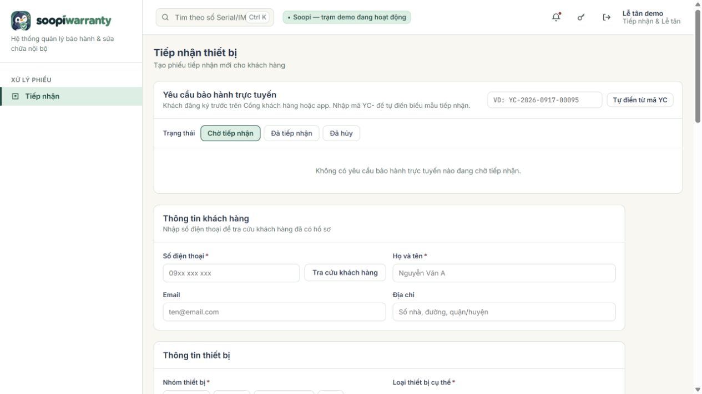
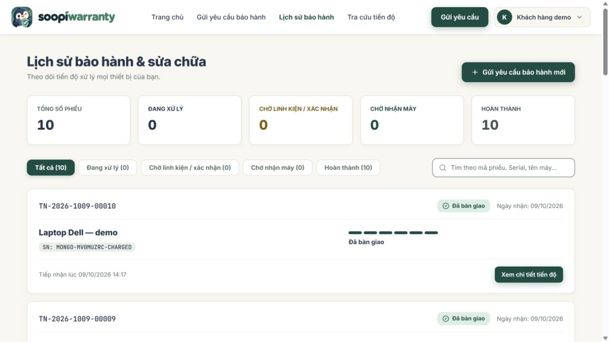
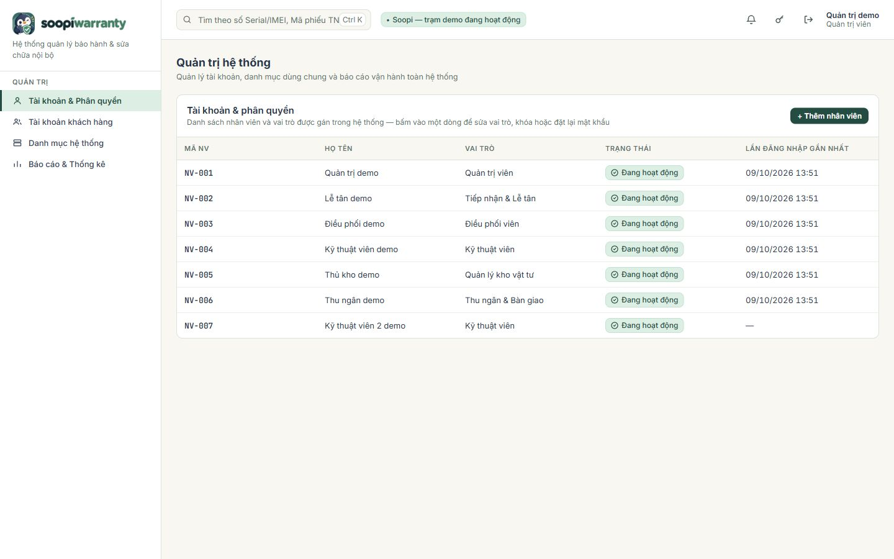
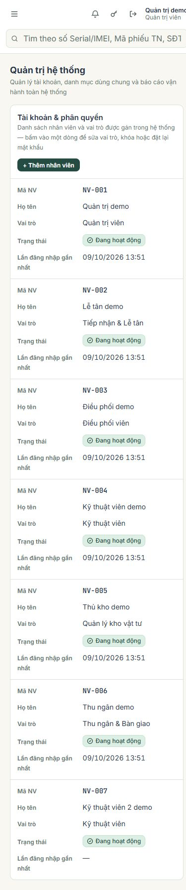

# Kiểm chứng Soopi MongoDB — 09/10/2026

## Phạm vi và kết quả

Project mới `warranty-system-soopi-mongodb`, database mới `soopi_mongodb`, MongoDB local `rs0`. Mã nguồn và database Soopi SQL Server/`service_center` được giữ nguyên. Không commit hay push tự động.

| Kiểm tra | Kết quả |
|---|---|
| Backend build qua `dotnet test` | Thành công, không cảnh báo compiler ở lần hoàn tất |
| Test backend | 61/61, không skip; gồm 10 test MongoDB integration |
| Frontend build, TypeScript/lint | Thành công |
| Test frontend | 25/25, không skip; gồm 11 test đăng nhập chung |
| Đối chiếu controller/UI/asset | 120 action HTTP giữ nguyên; 51 file giữ nguyên và 2 controller frontend đổi theo yêu cầu đăng nhập chung |
| Smoke HTTP trên MongoDB thật | 102 kiểm tra thành công |
| Browser thật | Đăng nhập `admin`, trang quản trị hiển thị 7 nhân viên từ MongoDB |
| Responsive | 1440×900 và 390×844; bảng chuyển thành thẻ trên điện thoại |

`verification/check-contract.mjs` đối chiếu route API (method + đường dẫn, bỏ qua tên tham số) với project nguồn: mọi route của bản gốc phải còn ở đây, route mới được phép và được liệt kê trong `contract-results.json`. Tính năng chat theo phiếu của bản gốc (`ChatController.cs`, `ChatBubble.tsx`) không đưa sang bản MongoDB và bị loại khỏi đối chiếu; kiểm tra báo lỗi nếu các file này xuất hiện ở đây. Không so từng file vì hai project đã phát triển riêng. Đây là bằng chứng giữ route cho client hiện có; không phải chứng minh tương đương mọi nhánh nghiệp vụ với SQL Server.

## Đăng nhập chung — cập nhật theo yêu cầu

Mọi tài khoản đăng nhập tại `/login`, mật khẩu demo chung `1234`. Liên kết `next=/account` không còn chặn nhân viên: tài khoản nhân viên chuyển về landing theo vai trò; khách hàng tiếp tục vào `/account` và giữ hash lịch sử phiếu. Nhân viên mở trực tiếp `/account` cũng được chuyển về trang công việc. Giữ kiểm tra quyền backend, chống redirect ra ngoài, chọn nhiều vai trò và bắt buộc đổi mật khẩu tạm.

11 test hồi quy kiểm tra các vai trò, phiên đăng nhập có sẵn, khách hàng, redirect ra ngoài, mật khẩu tạm và chọn nhiều vai trò. Browser thật xác nhận `receptionist / 1234` vào `/receptionist` từ liên kết khách hàng, mở trực tiếp `/account` trở lại trang Tiếp nhận; `0900000001 / 1234` vào `/account#lich-su` và hiển thị phiếu của khách.

## Luồng API đã thực hiện

- Đăng nhập và `/auth/me` cho 7 vai trò/tài khoản demo; xoay refresh token, phát hiện dùng lại token và logout.
- Danh mục, quản trị khách hàng, tìm khách, tra serial, tìm phiếu, tải kỹ thuật viên và tìm kiếm toàn cục.
- Hai luồng đầy đủ: đăng ký thiết bị → tiếp nhận → từ chối phiếu mở trùng → phân công → chẩn đoán → ghi chú → sửa/QC → xác nhận miễn phí hoặc thu tiền → chữ ký PNG → bàn giao → portal/lịch sử/phiếu bàn giao.
- Ca tính phí có báo giá, sửa dòng báo giá, điều phối duyệt, khách đồng ý, giữ linh kiện, xuất từ đúng kệ và kiểm lượng tồn/đã giữ.
- Tạo/sửa/duyệt phiếu nhập, tạo/duyệt điều chuyển và liệt kê chứng từ kho.
- Yêu cầu online với PNG, tra cứu token portal, xem yêu cầu của khách, tải lại đúng bytes của tệp và hủy yêu cầu.
- Báo cáo doanh thu, hiệu suất, thời gian xử lý, tỷ lệ bảo hành, sửa lại, đối chiếu báo giá, trạng thái và SLA; nhật ký/thông báo; đánh dấu đã đọc.

Kết quả HTTP chi tiết và mã phiếu demo: `verification/mongo-smoke-results.json`. Các lần chạy smoke tạo dữ liệu kiểm thử có nhãn demo trong database mới và file PNG/chữ ký ở thư mục lưu tệp riêng.

## Test MongoDB integration

Database riêng `soopi_mongodb_test_<GUID>`; chỉ database test vừa tạo được dọn. Kiểm tra private setters/enum/UTC/DateOnly, theo dõi thay đổi và chống ghi đè, rollback cả document và counter, unique số điện thoại, rollback khi sai kệ, giữ tồn đồng thời, phiên bản phiếu, thông tin/tìm kiếm phiếu theo hồ sơ khách đã đổi, từ chối tham chiếu danh mục không tồn tại hoặc child array sai kiểu, và dọn tệp vừa tạo khi MongoDB đã abort transaction.

## Bằng chứng giao diện

Giao diện kế thừa nguyên bản; không đổi thiết kế/tokens, chỉ đổi điều hướng đăng nhập theo yêu cầu. PRODUCT.md được cập nhật cho biến thể MongoDB, DESIGN.md giữ hệ thiết kế Soopi.

## Giới hạn

Chưa đối chiếu response từng endpoint với một SQL Server đang chạy và chưa thử tải lớn/replica-set failover. Các báo cáo tổng hợp trong bộ nhớ sau khi lọc theo ngày/trạm. OTP gửi qua Gmail SMTP khi có mật khẩu ứng dụng; API riêng của app di động và push đã được bỏ. Build Vite có cảnh báo `use client` từ react-router nhưng build/test/lint đều thành công.
